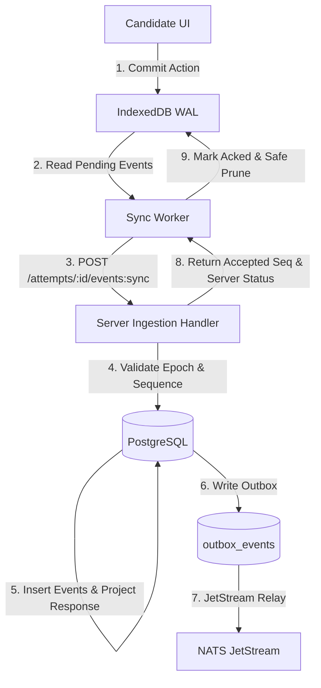
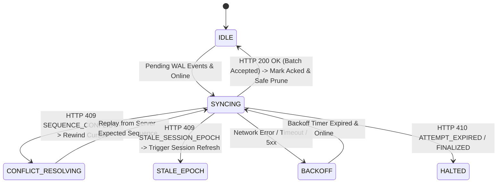
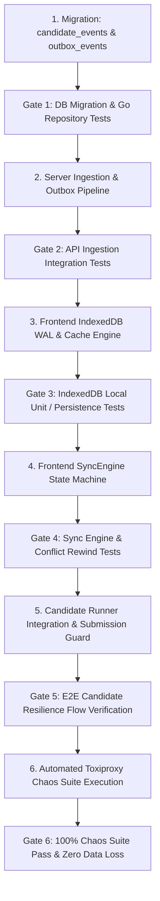

# Phase 4 — Resilience Core Implementation Plan

---

## 1. Phase Objective

The primary objective of **SentinelExam Phase 4 — Resilience Core** is to establish end-to-end resilience against client network disruptions, packet loss, high latency, and device/browser reboots during live assessment execution.

The core resilience guarantee is:
> **An already-started and locally bootstrapped attempt can continue during network disruption, subject to the server-authoritative attempt expiration window.**

The lifecycle of an offline event flows deterministically through:
$$\text{Normal Exam} \longrightarrow \text{Network Disruption} \longrightarrow \text{Local Persistence (IndexedDB WAL)} \longrightarrow \text{Offline Continuation} \longrightarrow \text{Reconnect} \longrightarrow \text{Batch Event Sync} \longrightarrow \text{Server Ingestion Pipeline} \longrightarrow \text{Reconciliation} \longrightarrow \text{Authoritative PostgreSQL State}$$

---

## 2. Scope

1. **Candidate Local Durability Engine**:
   - Browser IndexedDB storage schema (`sentinel_exam_db`).
   - Local Attempt Runtime cache for zero-latency offline resumption after bootstrap.
   - Monotonic Write-Ahead Log (WAL) for candidate interactions (`candidate.option_selected`, `candidate.text_entered`, `candidate.numeric_entered`, `candidate.answer_cleared`, `candidate.review_flagged`, `candidate.question_navigated`).
   - Strict local persistence-before-network transmission invariant.
   - Robust local WAL status lifecycle: `PENDING \rightarrow SYNCING \rightarrow ACKNOWLEDGED \rightarrow eligible\_for\_pruning \rightarrow PRUNED`.

2. **Candidate Event Model & Sync State Machine**:
   - Deterministic monotonic client sequence generation ($1, 2, 3, \dots, N$) scoped per attempt.
   - Session Epoch binding and client instance identification.
   - Resilient Sync Worker with bounded batching, exponential backoff, and jitter.
   - Accurate classification of server responses: exact duplicate acknowledgements, sequence gap conflict resets, stale epoch rejection, and attempt expiry.

3. **Server-Side Ingestion & Outbox Pipeline**:
   - Implementation of `POST /api/v1/attempts/{attemptId}/events:sync` batch ingestion endpoint.
   - Rigorous validation pipeline: authentication $\rightarrow$ authorization $\rightarrow$ schema check $\rightarrow$ epoch validation $\rightarrow$ monotonic sequence validation $\rightarrow$ ownership $\rightarrow$ temporal deadline validation.
   - Canonical persistence into `candidate_events` (including hash chaining hooks) and projection into `candidate_responses`.
   - Transactional emission into `outbox_events` for downstream NATS JetStream publication.

4. **Session Resilience & Authoritative Timer**:
   - Disconnect detection and non-disruptive reconnect lifecycle (`CONNECTED \leftrightarrow DISCONNECTED/RECONNECTING`).
   - Server-authoritative countdown timer with client clock-skew compensation, monotonic timer ticks, and offline expiry safety.
   - Submission synchronization guard preventing finalized submission while local WAL events remain un-synced.

5. **Toxiproxy Chaos & Verification Suite**:
   - Automated chaos test suite executing realistic network failure profiles (high latency + jitter, temporary TCP drops, intermittent packet loss, offline browser restarts, and reconnect-then-submit).

---

## 3. Explicit Non-Goals

* **NO Cold Offline Exam Start**: A candidate cannot start or initialize a brand new attempt without an initial network connection to authenticate and retrieve the runtime snapshot.
* **NO Conflict-free Replicated Data Types (CRDTs)**: State is strictly linear and server-authoritative; stale events serve as audit evidence, never overwriting newer server truth.
* **NO Client-Side Cryptographic Key Pair Management / WebCrypto Key Generation**: Client input is untrusted; the server verifies session and claims, and performs canonical hashing (per ADR-008).
* **NO Redis or Distributed In-Memory Caches**: PostgreSQL handles all hot transactional persistence (per ADR-001).
* **NO Kafka or ZooKeeper**: NATS JetStream handles all event stream buffering (per ADR-003).
* **NO AI in the Resilience Path**: AI remains strictly advisory and decoupled from sync/readiness probes (per ADR-006).
* **NO Modifying Verified Phase 3 Contracts**: Preserves all Phase 3 endpoints and state machine invariants.

---

## 4. Current Architecture Dependencies



---

## 5. Decision Classification

### LOCKED Decisions (Established by Frozen Documentation)
1. **PostgreSQL as Authoritative Source of Truth**: Client storage is strictly uncommitted evidence (ADR-001, Architecture Spec).
2. **IndexedDB WAL Invariant**: Every interaction is committed to IndexedDB before any network dispatch (ADR-005, Failure & Recovery Spec).
3. **Monotonic Sequences Scoped to Attempt**: Sequence numbers are strictly increasing per attempt ($1, 2, 3\dots, N$). `session_epoch` identifies the authoritative client session and prevents stale tabs from mutating state (Event Contract, Database Schema).
4. **Server-Authoritative Expiration**: Timers are computed strictly from server `expires_at` with client clock-skew adjustment. Client local clocks cannot extend exam deadlines (State Machines Spec).
5. **Untrusted Client Boundary**: Server validates event sequence, epoch, and payload, and generates the canonical audit hash chain (ADR-008, Security Spec).

### PROPOSED Phase 4 Decisions (Architecture for Implementation)
1. **Unified Sync Endpoint**: Implement `POST /api/v1/attempts/{attemptId}/events:sync` supporting array batch ingestion within an atomic database transaction.
2. **PostgreSQL Schema Migration**: Add migration `000003_resilience_events.sql` to create `candidate_events` and `outbox_events` tables with complete schema fields matching the canonical event model.
3. **Configurable Batch & Flush Policy**: Background sync worker defaults to a bounded batch size (up to 50 events) with a flush debounce window (default 200ms) or immediate flush on question navigation and exam submission.
4. **Two-Tier IndexedDB Object Stores**:
   - `runtime_cache`: Stores the latest cached `AttemptRuntime` payload and skew offsets.
   - `event_wal`: Stores ordered candidate events with lifecycle tracking (`PENDING \rightarrow SYNCING \rightarrow ACKNOWLEDGED \rightarrow PRUNED`).

### OPEN DECISIONS (To Be Refined During Verification)
1. **PostgreSQL Transaction Isolation for Ingestion**: Start with standard PostgreSQL `READ COMMITTED` with row-level locking on `exam_attempts` / `assessment_sessions` (`SELECT ... FOR UPDATE`), evaluating whether higher isolation is required during concurrent chaos verification.
2. **Local WAL Retention Threshold**: Maintain acknowledged events in IndexedDB until attempt completion or prune entries older than $K$ acknowledged batches to maintain low storage footprint.

---

## 6. Local IndexedDB & WAL Design

### Database Name: `sentinel_exam_db` (Version 1)

#### Object Store 1: `runtime_cache`
* **Key**: `attempt_id` (string UUID)
* **Schema**:
```typescript
interface CachedAttemptRuntime {
  attempt_id: string;
  exam_id: string;
  candidate_id: string;
  expires_at: string;
  duration_seconds: number;
  session_epoch: number;
  server_time_skew_ms: number; // Server Timestamp - Client Date.now() at fetch
  monotonic_anchor_ms: number; // performance.now() recorded at synchronization
  questions: RuntimeQuestion[];
  responses: Record<string, any>; // question_version_id -> value
  cached_at: number;
}
```

#### Object Store 2: `event_wal`
* **Key**: `[attempt_id, sequence_number]` (Compound Array Key)
* **Indexes**:
  * `by_attempt_status`: `[attempt_id, sync_status]`
  * `by_attempt_seq`: `[attempt_id, sequence_number]`
  * `by_event_id`: `event_id`
* **Schema**:
```typescript
interface CandidateWALEvent {
  event_id: string;              // UUID v4
  attempt_id: string;            // UUID
  session_id: string;            // UUID
  session_epoch: number;         // Integer >= 0
  sequence_number: number;       // Monotonic sequence (1, 2, 3...)
  event_type: CandidateEventType;
  client_instance_id: string;    // Browser tab instance UUID
  client_timestamp: string;      // ISO 8601 UTC
  payload: {
    question_version_id?: string;
    value?: any;
    section_name?: string;
    action?: string;
  };
  sync_status: 'PENDING' | 'SYNCING' | 'ACKNOWLEDGED' | 'REJECTED';
  retry_count: number;
  last_attempted_at?: number;
  error_message?: string;
  created_at: number;
}
```

### Local WAL Cleanup Lifecycle
```
User Action
    │
    ▼
[PENDING] (Durable commit in IndexedDB)
    │
    ▼ (Batch dispatched via HTTP)
[SYNCING]
    │
    ├── (HTTP 200 with last_committed_sequence >= seq)
    ▼
[ACKNOWLEDGED]
    │
    ▼ (Marked eligible for pruning; retained across browser restart until flushed)
[PRUNED] (Safely removed from local store after batch verification or exam finalization)
```
* **Crash Recovery**: If the browser crashes while events are in `SYNCING` state, upon relaunch they automatically revert to `PENDING` and are re-evaluated against the server's `last_committed_sequence`.

---

## 7. Canonical Candidate Event Model

To maintain complete alignment with `docs/EVENT_CONTRACT.md`, `docs/AUDIT.md`, and `docs/DATABASE_SCHEMA.md`, the server event schema preserves all canonical fields:

```json
{
  "event_id": "00000000-0000-0000-0000-000000000101",
  "attempt_id": "00000000-0000-0000-0000-000000000001",
  "candidate_id": "00000000-0000-0000-0000-000000000002",
  "session_id": "00000000-0000-0000-0000-000000000010",
  "session_epoch": 1,
  "sequence_number": 42,
  "event_type": "sentinel.candidate.option_selected",
  "schema_version": "1.0",
  "client_instance_id": "tab-inst-987",
  "client_timestamp": "2026-09-30T18:20:00.100Z",
  "server_received_at": "2026-09-30T18:20:00.250Z",
  "payload": {
    "question_version_id": "00000000-0000-0000-0000-000000000020",
    "value": { "selected": "B" }
  },
  "processing_status": "COMMITTED"
}
```

* **Derived Fields**: `candidate_id` is derived server-side from the authenticated JWT claims. `server_received_at` is assigned by PostgreSQL `NOW()`. `processing_status` reflects ingestion state.

---

## 8. Idempotency vs. Sequence Validation Matrix

The server ingestion pipeline evaluates each event in a batch against the attempt's current state:

| Incoming Event Condition | Server Validation Result | Database Action | Sync Response Behavior |
| :--- | :--- | :--- | :--- |
| $\text{seq} \le \text{last\_committed\_seq}$ & $\text{event\_id}$ matches existing row | **EXACT DUPLICATE** (Idempotent Retry) | No-op (Already persisted) | Counted as processed; server returns current $\text{last\_committed\_seq}$. |
| $\text{seq} \le \text{last\_committed\_seq}$ & $\text{event\_id}$ does NOT match | **SEQUENCE CONFLICT / FORK** | Rejects event / logs anomaly | Returns `HTTP 409 SEQUENCE_CONFLICT` with current committed state. |
| $\text{seq} == \text{last\_committed\_seq} + 1$ & Valid Epoch | **VALID NEXT SEQUENCE** | Inserts `candidate_events`, projects `candidate_responses`, writes outbox | Accepted; advances $\text{last\_committed\_seq}$. |
| $\text{seq} > \text{last\_committed\_seq} + 1$ | **SEQUENCE GAP** (Missing prior events) | Transaction Rollback | Returns `HTTP 409 SEQUENCE_CONFLICT` with `expected_sequence: last_committed_seq + 1`. Client rewinds and replays. |
| $\text{session\_epoch} < \text{attempt.session\_epoch}$ | **STALE SESSION EPOCH** | Transaction Rollback | Returns `HTTP 409 STALE_SESSION_EPOCH`. Event recorded as audit anomaly without mutating state. |
| $\text{now}() > \text{attempt.expires\_at}$ | **ATTEMPT EXPIRED** | Transaction Rollback | Returns `HTTP 410 ATTEMPT_EXPIRED`. Rejects state mutations. |
| Attempt status is `FINALIZED` or `SUBMITTED` | **ATTEMPT NOT ACTIVE** | Transaction Rollback | Returns `HTTP 409 ATTEMPT_FINALIZED`. Rejects state mutations. |

---

## 9. Sync Engine State Machine



---

## 10. Robust Server-Authoritative Timer Model

1. **Authoritative Expiration Window**:
   - `expires_at` is determined by PostgreSQL upon attempt creation (`started_at + duration_seconds`).
2. **Client Countdown Clock**:
   - Client calculates `skew_ms = ServerTimestamp - ClientLocalWallClock` during initial load and subsequent API sync responses.
   - For continuous display while the tab remains open, the client uses a monotonic tick based on `performance.now()`.
   - $\text{TimeElapsedMonotonic} = \text{performance.now()} - \text{monotonic\_anchor\_ms}$.
   - $\text{RemainingSeconds} = \max\left(0, \left\lfloor \frac{(\text{expires\_at\_ms} - (\text{server\_anchor\_time\_ms} + \text{TimeElapsedMonotonic}))}{1000} \right\rfloor\right)$.
3. **Protection Against Wall-Clock Manipulation**:
   - Modifying the OS or system clock does not affect `performance.now()` elapsed calculations.
   - Page refresh or device reboot re-anchors timing against cached/server metadata.
4. **Reconnect Expiry Check**:
   - On reconnect, every sync response returns `server_timestamp`, validating whether the attempt remains active.

---

## 11. Submission Synchronization & Local Intent

* **Distinction**:
  - `Local Submission Intent`: A client-side state triggered when the candidate clicks "Submit" or local countdown reaches zero. It locks further answer changes in the UI and initiates a full sync flush.
  - `Authoritative Submission / Finalization`: The formal server-side state transition triggered by `POST /api/v1/attempts/{attemptId}/submit`, which verifies eligibility, freezes `candidate_responses`, calculates scores, and sets status to `FINALIZED`.
* **Submission Synchronization Guard**:
  ```
  Candidate clicks "Submit Exam"
      │
      ├── 1. UI sets local state: isSubmitting = true (Disables inputs)
      ├── 2. Query IndexedDB: pending_events_count
      ├── 3. If pending > 0:
      │       ├── Display "Synchronizing pending answers with server..."
      │       ├── SyncEngine.flushAll()
      │       └── Await 0 pending WAL items
      ├── 4. Dispatch POST /api/v1/attempts/{attemptId}/submit
      ├── 5. Server finalizes attempt & computes deterministic score
      └── 6. Client receives 200 OK -> navigates to ResultPage
  ```

---

## 12. Database Schema Impact (Migration `000003_resilience_events.sql`)

```sql
-- -----------------------------------------------------------------------
-- CANDIDATE EVENTS (Sequenced Append-Only WAL Table)
-- -----------------------------------------------------------------------
CREATE TABLE candidate_events (
    id                   UUID PRIMARY KEY DEFAULT gen_random_uuid(),
    event_id             UUID NOT NULL UNIQUE,
    attempt_id           UUID NOT NULL REFERENCES exam_attempts(id) ON DELETE RESTRICT,
    session_id           UUID REFERENCES assessment_sessions(id) ON DELETE RESTRICT,
    session_epoch        INTEGER NOT NULL,
    sequence_number      BIGINT NOT NULL,
    event_type           TEXT NOT NULL,
    schema_version       TEXT NOT NULL DEFAULT '1.0',
    client_instance_id   TEXT NOT NULL,
    payload              JSONB NOT NULL DEFAULT '{}',
    client_timestamp     TIMESTAMPTZ NOT NULL,
    server_received_at   TIMESTAMPTZ NOT NULL DEFAULT NOW(),
    prev_hash            TEXT,
    event_hash           TEXT,
    processing_status    TEXT NOT NULL DEFAULT 'COMMITTED',

    CONSTRAINT unique_attempt_sequence UNIQUE (attempt_id, sequence_number)
);

CREATE INDEX idx_candidate_events_attempt_seq ON candidate_events(attempt_id, sequence_number);
CREATE INDEX idx_candidate_events_event_id ON candidate_events(event_id);

-- -----------------------------------------------------------------------
-- OUTBOX EVENTS (Transactional Outbox for JetStream Relay)
-- -----------------------------------------------------------------------
CREATE TABLE outbox_events (
    id                   UUID PRIMARY KEY DEFAULT gen_random_uuid(),
    event_type           TEXT NOT NULL,
    stream_name          TEXT NOT NULL,
    subject              TEXT NOT NULL,
    payload              JSONB NOT NULL,
    status               TEXT NOT NULL DEFAULT 'PENDING',
    created_at           TIMESTAMPTZ NOT NULL DEFAULT NOW(),
    published_at         TIMESTAMPTZ
);

CREATE INDEX idx_outbox_pending ON outbox_events(created_at) WHERE status = 'PENDING';
```

---

## 13. Toxiproxy Chaos Engineering Test Matrix

| Scenario ID | Fault Injection Profile | Expected Client Behavior | Expected Server Behavior | Database & Authoritative Outcome Verification |
| :--- | :--- | :--- | :--- | :--- |
| **CHAOS-01** | **High Latency & Jitter** (1500ms latency + 500ms jitter via Toxiproxy) | Answers persist to IndexedDB immediately; UI remains non-blocking; background sync drains with delayed ACKs. | Ingestion pipeline accepts batches; returns 200 OK. | All response rows in PostgreSQL `candidate_responses` match candidate selections with 100% fidelity. |
| **CHAOS-02** | **Temporary Connection Drop** (30s TCP stream cut) | Heartbeat flags `DISCONNECTED`; candidate continues answering offline; local WAL queues 10 events. | Zero network traffic during cut; session and timer remain active. | Upon restoration, sync worker drains all 10 events in strict sequence; PostgreSQL records 10 distinct `candidate_events`. |
| **CHAOS-03** | **Intermittent Packet Loss & Duplicate Retries** (30% packet loss) | Sync worker retries dropped HTTP requests; sends partially overlapping batches. | Deduplication engine skips already committed `sequence_number` rows; processes new items. | Zero duplicate rows in `candidate_events`; `candidate_responses` contains final expected answer values. |
| **CHAOS-04** | **Browser Restart While Disconnected** (Page reload during active outage) | Candidate reloads browser while offline; runtime loads from IndexedDB cache; offline edits queue in WAL. | Zero hits during outage. | On reconnect, re-establishes session and drains WAL without data loss. |
| **CHAOS-05** | **Offline Reconnect & Immediate Submission** (Offline answering $\rightarrow$ reconnect $\rightarrow$ submit) | Candidate completes 5 questions offline, reconnects, and clicks "Submit" immediately. | Sync flush drains WAL completely before `POST /submit` endpoint executes. | `submissions.score` evaluated deterministically from 100% of candidate answers; attempt marked `FINALIZED`. |

---

## 14. Implementation Sequence & Verification Gates



### Detailed Verification Gates:
1. **Gate 1**: Go repository unit tests verify sequential insertion, duplicate rejection, and outbox insertion in `candidate_events`.
2. **Gate 2**: API integration tests verify `POST /attempts/{attemptId}/events:sync` with valid, duplicate, gap-conflict (`409`), and stale epoch (`409`) payloads.
3. **Gate 3**: Frontend unit verification verifies IndexedDB schema creation, WAL event persistence, and offline runtime retrieval.
4. **Gate 4**: Sync worker test verifies queue draining, exponential backoff, and cursor rewind on sequence conflict.
5. **Gate 5**: End-to-end integration test verifies uninterrupted test-taking through offline states with submission flush guard.
6. **Gate 6**: Toxiproxy automated test harness passes all 5 chaos test scenarios (`CHAOS-01` through `CHAOS-05`) with 100% data consistency in PostgreSQL.

---

## 15. Phase Completion Criteria

Phase 4 is integration-verified and complete only when:
1. An already-bootstrapped candidate attempt can continue smoothly during total network disconnection.
2. Every interaction is committed synchronously to browser IndexedDB WAL before network dispatch.
3. Network reconnection automatically drains all queued events in monotonic sequence without data loss.
4. Submission synchronization guard prevents premature finalization until all local WAL events are acknowledged.
5. Automated Toxiproxy chaos suite passes all 5 network chaos test profiles with PostgreSQL verification.
6. Backend tests, full API integration suite, and frontend production builds remain 100% green.
